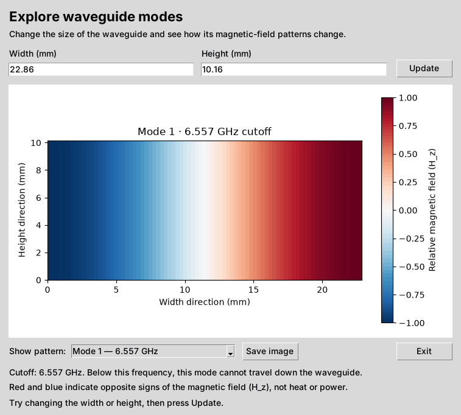
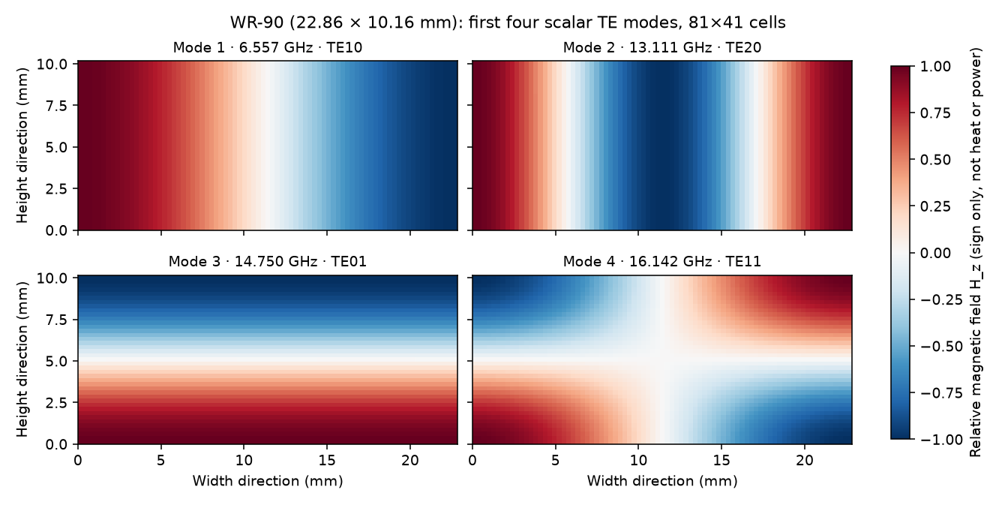
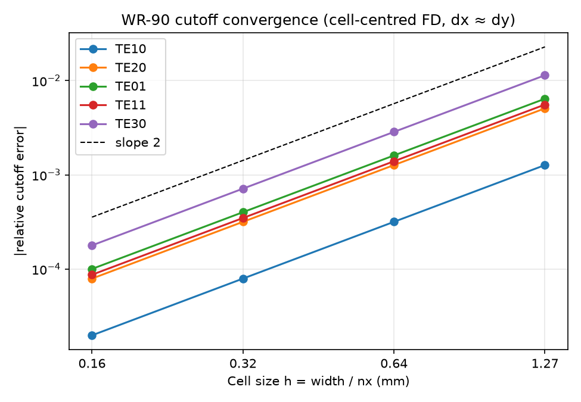

# OpenWave

[](https://github.com/adi05rjn/openwave-mvp/actions/workflows/tests.yml)


**Learn RF waveguide modes by changing dimensions and watching the field patterns.**

OpenWave is an early open-source teaching tool for rectangular waveguides. It shows the first four transverse-electric (TE) modes, their cutoff frequencies, and the corresponding **relative longitudinal magnetic-field** (`H_z`) patterns.

No scripting or solver configuration is needed to use the desktop interface.

<p align="center">
  
</p>

<sub>The desktop app, captured from the real window, stepping through its four patterns. Red and blue are opposite signs of the field, not heat or power. Which colour lands on which side can swap each time you launch the app, so only the contrast within one picture matters.</sub>

## Try it on Linux

You need Python 3.10+ and a graphical desktop. Tkinter is required for the desktop interface. On Ubuntu/Debian, install the prerequisites first:

```bash
sudo apt update
sudo apt install -y git python3-venv python3-tk
```

On other Linux distributions (including Arch-based systems), install Python, Tk, and Python virtual-environment support using your package manager.

```bash
git clone https://github.com/adi05rjn/openwave-mvp.git
cd openwave-mvp
python3 -m venv .venv
source .venv/bin/activate
python -m pip install -e .
openwave-gui
```

## Your first experiment (about two minutes)

1. **OpenWave starts with an example already displayed.** The initial waveguide is 22.86 mm wide and 10.16 mm tall.
2. Look at the colored pattern: red and blue represent opposite signs of the magnetic field `H_z`, **not heat or power**.
3. Change **Width (mm)** from `22.86` to `30` and press **Update**.
4. Notice how the field pattern and the **cutoff frequency** change.
5. Choose another pattern using **Show pattern**. You can save the image or close the window with **Exit** (or Esc).

**What is cutoff frequency?** Each waveguide mode has a minimum frequency needed to travel through the guide. Below its cutoff, the mode does not propagate along the guide.

**What is a mode?** A particular electromagnetic field pattern that can exist inside the waveguide.

<p align="center">
  
</p>

<sub>The first four patterns for the starting example (WR-90). "Mode 1" to "Mode 4" are the solver's order by cutoff frequency. The TE labels were added only after checking each cutoff against its analytical value for this guide; they are not guaranteed to match for other sizes or meshes. See the [validation dossier](docs/VALIDATION.md).</sub>

## Optional command line

The command-line interface is useful for further experiments but is **not needed** for the GUI.

```bash
openwave --width-mm 22.86 --height-mm 10.16 --modes 4 --plot artifacts/mode1.png
```

It prints cutoff frequencies in GHz and saves a PNG of the first mode.

## AI-agent experiments (headless)

Agents can create versioned JSON experiments and run the existing solver without
opening the GUI or using an LLM-specific dependency:

```bash
openwave schema
openwave validate examples/wr90.json
openwave run examples/wr90.json --output artifacts/wr90-agent
```

The run saves structured cutoff results, normalized fields, coordinates, the
validated input, and provenance hashes. Output directories must be new.
See the [AI-agent workflow](docs/AI_AGENT_WORKFLOW.md) for the format, Python API,
error protocol, reproducibility limits, and an example agent prompt.
The desktop interface and original flag-based command remain available.

MCP-compatible agents can also use OpenWave through a local stdio server with
`get_experiment_schema`, `validate_experiment`, and `run_experiment` tools.
Python 3.11+ is needed **only for this optional integration**:

```bash
python -m pip install -e '.[mcp]'
openwave-mcp --output-root ./artifacts/mcp
```

See [MCP server setup and safety limits](docs/MCP_SERVER.md) to connect an
agent and run the automated MCP client tests.

## For developers

```bash
python -m pip install -e '.[dev]'
python -m pytest -q
```

The solver uses a cell-centred 2-D grid and a scalar finite-difference TE eigenproblem. The repository includes analytical cutoff and mesh-convergence tests. See [architecture notes](docs/ARCHITECTURE.md).

The [validation dossier](docs/VALIDATION.md) derives the expected error, checks several geometries and higher-order modes, documents sign, indexing and degeneracy pitfalls, and compares the GUI, CLI, JSON and MCP interfaces. Regenerate it with `python benchmarks/validation_dossier.py --output artifacts/validation`.

<p align="center">
  
</p>

<sub>Cutoff error against cell size: second-order convergence, as derived in the dossier.</sub>

The images in this README are generated, not drawn: `python benchmarks/make_readme_figures.py` (add `--gui` under a display, e.g. `xvfb-run -a`, to re-capture the real window).

## Current limits

OpenWave only handles ideal, perfectly conducting, rectangular waveguides and scalar TE modes. It does **not** yet support TM modes, driven simulations, S-parameters, conductor losses, arbitrary CAD geometries, or full 3-D electromagnetic fields.

It is an educational prototype, not a substitute for a full-wave RF design tool.

## License

Apache-2.0. See [LICENSE](LICENSE) for the full text and [NOTICE](NOTICE) for the copyright notice.
